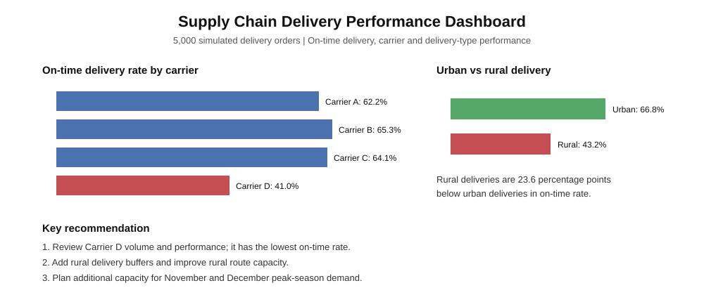

# Generated Analysis Results

The analysis was run on 5,000 synthetic delivery orders.

## Dashboard

## Carrier performance

| Carrier | Orders | On-time rate | Average delivery days | Average cost (EUR) |
|---|---:|---:|---:|---:|
| Carrier A | 1,503 | 62.2% | 4.66 | 17.50 |
| Carrier B | 1,434 | 65.3% | 4.63 | 17.33 |
| Carrier C | 1,172 | 64.1% | 4.58 | 17.34 |
| Carrier D | 891 | 41.0% | 5.00 | 18.07 |

## Delivery type performance

| Delivery type | Orders | On-time rate | Average delivery days |
|---|---:|---:|---:|
| Rural | 1,503 | 43.2% | 4.96 |
| Urban | 3,497 | 66.8% | 4.58 |

## Key insight

Carrier D has the lowest on-time delivery rate at 41.0%, while rural deliveries perform substantially worse than urban deliveries. The analysis recommends reviewing Carrier D volume, improving rural delivery capacity, and planning additional capacity during peak months.
